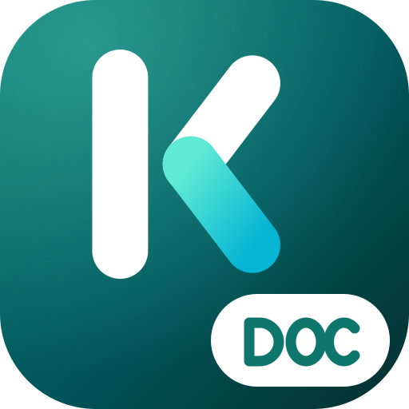

<p align="center"></p>

# Kampus Docs

The documentation of [Kampus](https://github.com/didactika/kampus) for every role: learners, teachers, administrators, operators, integrators, plugin developers and platform developers. It is versioned with Kampus: the `release/X.Y.Z` branch describes Kampus `X.Y.Z`, and `main` holds the released versions.

## Run it

Nothing but Git and Docker is needed. With the Kampus repository cloned next to this one:

```bash
docker compose up -d        # http://localhost:8096
docker compose logs -f site
docker compose down
```

Pages reload when you edit them; the server polls for changes (`KAMPUS_DOCS_POLL`), so this also works with Docker on Windows. Every 30 seconds `tools/sync-spec.mjs` reads the Kampus repository (`KAMPUS_REPO_DIR`, by default `../kampus`) and refreshes the use cases each guide lists, with their status, and the changelog.

## Layout

| Path | Content |
| --- | --- |
| `src/content/docs/<audience>/` | The guides of each audience, in English |
| `src/content/docs/es/<audience>/` | The same guides in Spanish; a missing page falls back to English |
| `src/components/` | The site title and the use-case list |
| `src/styles/kampus-docs.css` | The look of Didactika's documentation: palette, typography, components |
| `tools/sync-spec.mjs` | Synchronisation with the Kampus repository |

## Contributing

Every source file starts with the Kampus file header (`node tools/check-headers.mjs --fix --author "Your Name <you@example.org>"` writes it); pages are Markdown or MDX with front matter. Each change adds its entry to `CHANGELOG.md`.

## Licence

GNU Affero General Public License, version 3 or later. Copyright (c) 2026 Didactika. See [LICENSE](LICENSE).
